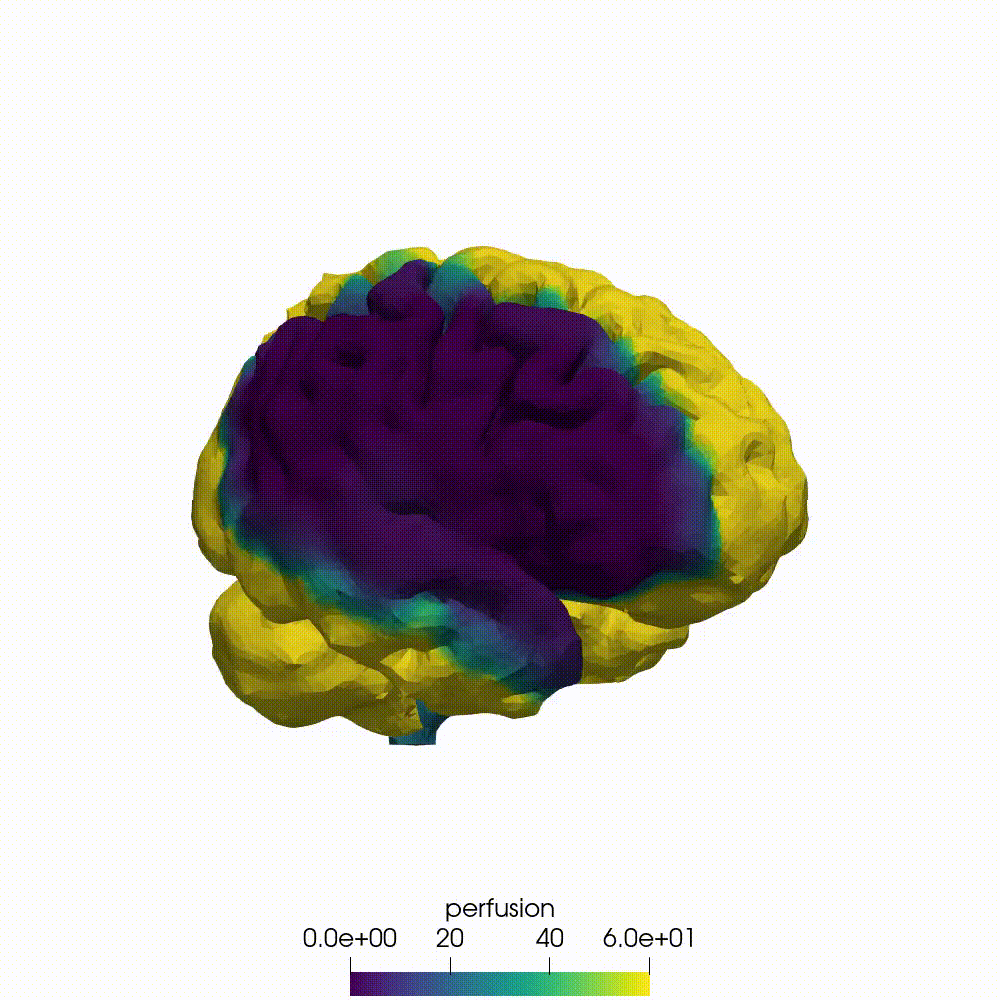

# Perfusion model

[](https://www.python.org/)
[](https://fenicsproject.org/)

The perfusion model is part of the GEMINI project. For more information, please see one of these links :

- [GEMINI's website](https://dth-gemini.eu/)
- [A paper about the perfusion model](https://royalsocietypublishing.org/doi/10.1098/rsfs.2019.0125)

Perfusion models the amount of blood delivered to a given amount of tissue in a given time, expressed in **[ml/min/100g]**.

---

# Simulation Preview (RMCAo Case)

Here is a 360° rotation view of a simulated right middle cerebral artery occlusion (**RMCAo**) resulting in a distinct perfusion deficit (hypoperfusion area in purple/blue):

<p align="center">
  
</p>

---

# Table of contents

- [About the Project](#-about-the-project)
- [Brain Meshes & Clinical Data](#-brain-meshes--clinical-data)
- [State of the branch](#-state-of-the-branch)
- [Pipeline](#-pipeline)
- [Accessing the documentation](#-accessing-the-documentation)
  
# About the Project

Perfusion models the amount of blood delivered to a given amount of tissue in a given time, typically expressed in $\text{ml/min/100g}$. This repository provides robust numerical solvers to compute pressure fields, velocity profiles, permeability tensors, and ischemic lesion volume proxies across healthy and occluded cerebral vasculature cases (e.g., MCAo, ACAo, PCAo).

## Brain Meshes & Clinical Data

The finite element models rely on patient-specific and standardized high-resolution brain meshes derived from clinical neuroimaging data.

- **Mesh Archive**: The compressed brain geometry files are packaged in `brain_meshes.tar.xz`.
- **Mesh Source**: The brain mesh is adapted from [Garcia-Gonzalez et al. (2017)](#-references), *"On the mechanical behaviour of PEEK and HA cranial implants under impact loading"*.
- **Anatomical Regions**: Cortical surface regions and arterial territories are systematically indexed (e.g., ACA, MCA, PCA for both left and right hemispheres) to handle focal occlusions accurately and capture the wide inter-patient variability inherent to clinical stroke data.

## State of the branch

This repository is currently undergoing an active migration phase from Legacy FEniCS to modern **FEniCS-X**:

- **`src/Legacy_version/`**: Fully refactored and modularized codebase using legacy FEniCS.
- **`src/X_version/`**: Modernized implementation leveraging FEniCS-X for high-performance parallel computing (`basic_flow_solver_x.py`, `permeability_initialiser_x.py`).
- **`images/`**: Contains visual assets and simulation plots for documentation and paper figures.
- **`test/`**: Unit tests and verification fixtures (including rotated cube validation meshes).

# Getting started

You can either run the code on your local machine, or in a HPC systems. For more information, please see [the HPC page](hpc_submission/README.md).

If you have Apptainer installed - also named Singularity - you can build a container image using the following command. 

```bash
apptainer build containers/container.sif containers/container.def
```

However, if you don't have it installed, you can also run it locally on your machine. 
We recommend having a Linux machine to run it. If you own a Windows machine, you can install a Linux one with wsl. 
Please follow the link to install wsl if you do not have it: [Installing wsl](https://learn.microsoft.com/en-us/windows/wsl/install).

You need to have a conda environment installed on your Linux environment. 
If you don’t possess one, please enter the following commands to install Miniconda. 
The required version of python is 3.9.

```bash
wget https://repo.anaconda.com/miniconda/Miniconda3-latest-Linux-x86_64.sh
bash Miniconda3-latest-Linux-x86_64.sh
```

After installing the package manager you need to activate conda and create a custom environment to run your code on.
You can create the environment with the following command. 

For the [Legacy_version](src/Legacy_version):

````bash
source ~/miniconda3/bin/activate
conda create -n fenics-legacy -c conda-forge fenics python=3.9
conda activate fenics-legacy
````

For the [X_version](src/X_version):

````bash
source ~/miniconda3/bin/activate
conda create -n dolfinx -c conda-forge fenics-dolfinx python=3.11 numpy pytest
conda activate dolfinx
````

**Remember to activate both conda and fenics-env/dolfinx everytime you want to use the code**

The requirements need to be installed as well into your conda environment. Use the following command to do so.

````bash
pip install -r requirements.txt
````

The brain meshes are compressed in a .zip file. Before running the code, you will need to extract those. 
Use the following command.

````bash
tar xf ../brain_meshes.tar.xz
````

The perfusion_runner.sh needs to be set as an executable file for it to run successfully.
More information about what the perfusion_runner.sh does can be found in the [Main pipeline section](#main-pipeline).

For the [Legacy_version](src/Legacy_version):

````bash
cd ~/perfusion_and_tissue_damage_IRP_2026/perfusion/
chmod +x perfusion_runner.sh
./perfusion_runner.sh
````

For the [X_version](src/X_version):

````bash
cd ~/perfusion_and_tissue_damage_IRP_2026/perfusion/
chmod +x perfusion_runner_x_version.sh
./perfusion_runner_x_version.sh
````

# Pipeline
## Initialisation tasks

To be able to run the main pipeline, some preliminary tasks need to be carried out.
The following tasks only need to be run once: 

1. **Extract the brain meshes**:

- Unpack `brain_meshes.tar.xz` into the project directory.
- This command only need to be run once.
- You can use the following command if necessary:

```
tar xf ../brain_meshes.tar.xz
```

2. **Initialise the permeability tensor**:

- Run `permeability_initialiser.py` or `permeability_initialiser_x.py` to compute the permeability tensor.
- This simulation only need to be run once.
- You can use the following command to run it in parallel from the project directory:

For the [Legacy_version](src/Legacy_version):

```
mpirun -n 4 python3 -m src.Legacy_version.simulation.permeability_initialiser --config_file ./configs/config_permeability_initialiser.yaml
```

For the [X_version](src/X_version):

```
mpirun -n 4 python3 -m src.X_version.simulation.permeability_initialiser --config_file ./configs/config_permeability_initialiser.yaml
```

- Uses `config_permeability_initialiser.yaml` as a configuration file. It contains information about the mesh file, the output folder or physical parameters such as the arteriole/venule permeability tensor form.
- This simulation will take up to 5 min with 4 cores, depending of the environment you are using (HPC systems, local). More information about the performance can be found here: `Performance <performance.html>`_.

When those task have been done, the main pipeline can be performed. 

## Main pipeline

1. **Create boundary conditions**:

- Generate boundary conditions for all scenarios, but especially occluded scenarios (e.g., LMCAo, RMCAo):
- You can use the following command to run it in serial from the project directory:

For the [Legacy_version](src/Legacy_version):

````bash
python3 -m src.Legacy_version.simulation.BC_creator --config_file ./configs/config_basic_flow_solver.yaml
````

For the [X_version](src/X_version):

````bash
python3 -m src.X_version.simulation.BC_creator_x --config_file ./configs/config_basic_flow_solver.yaml
````

- The command presented here is adapted to a healthy case. To adapt it to an occluded case, please update the argument of the command.
- Update `config_basic_flow_solver.yaml` to point to the generated boundary conditions file and change the output folder to avoid overwriting.
- In the *.csv summarising the boundary conditions the cortical surface regions are numbered so that:
    - 21 - left ACA
    - 22 - left MCA
    - 23 - left PCA
    - 24 - right ACA
    - 25 - right MCA
    - 26 - right PCA

2. **Solve Flow**:

- Run `basic_flow_solver.py` or `basic_flow_solver_x.py` for pressure and velocity fields.
- You can use the following command to run it in parallel from the project directory:

````bash
mpirun -n 4 python3 -m src.Legacy_version.simulation.basic_flow_solver --config_file ./configs/config_basic_flow_solver.yaml
````

- Uses `config_basic_flow_solver.yaml` as a configuration file. It contains information about the input and outputs files and folders, about physical, simulation and optimisation parameters.
- This simulation will take up to 6 min with 4 cores, depending of the environment you are using (HPC systems, local). More information about the performance can be found here: `Performance <performance.html>`_.
- The simulation has already three different cases supported: a healthy brain, a LMCAo and a RMCAo case. Three configurations files are available.:
    - ``config_basic_flow_solver.yaml``
    - ``config_basic_flow_solver_LMCAo.yaml``
    - ``config_basic_flow_solver_RMCAo.yaml``

## Additional simulations


Additional results can be produced using the following simulations, after the main pipeline have been produced one.

1. **Convert the finite element results to a NIFTI format**:

- Run `convert_res2img.py` to convert a ``.h5`` or ``.xdmf`` to a ``.nii.gz`` format.
- You can use the following command to do so:

````bash
python3 -m src.Legacy_version.io.convert_res2img --config_file ./results/p0000/perfusion_healthy/settings.yaml
````

- Use the configuration file of the results you want to convert. Three files are available, once the main pipeline has been run for the three cases (healthy, LMCAo, RMCAo):
    - ``./results/p0000/perfusion_healthy/settings.yaml``
    - ``./results/p0000/perfusion_LMCAo/settings.yaml``
    - ``./results/p0000/perfusion_RMCAo/settings.yaml``

2. **Compute lesion volume proxies from brain perfusion images**:

- Run `lesion_comp_from_img.py` to compute the lesion volume proxies form a healthy and occluded brain perfusion images.
- Use the following command to run it in serial from the project directory:

````bash
python3 -m src.Legacy_version.simulation.lesion_comp_from_img --healthy_file ./results/p0000/perfusion_healthy/perfusion.nii.gz --occluded_file ./results/p0000/perfusion_RMCAo/perfusion.nii.gz
````

- Use the healthy and occluded images you want to test. The inputted files should be in the NIFTI format (``.nii.gz``).

3. **Compute infarct volumes across a range of perfusion thresholds**:

- Run `infarct_calculation_thresholds.py` to compute infarct volumes across a range of perfusion thresholds.
- Use the following command to run it in parallel from the project directory:

````bash
mpirun -n 4 python3 -m src.Legacy_version.simulation.infarct_calculation_thresholds --config_file ./configs/config_basic_flow_solver_RMCAo.yaml --baseline ./results/p0000/perfusion_healthy/perfusion.xdmf --occluded ./results/p0000/perfusion_RMCAo/perfusion.xdmf
````

- Use the configuration file of the results you want to convert. Three files are available, once the main pipeline has been run for the three cases (healthy, LMCAo, RMCAo):
    - ``./results/p0000/perfusion_healthy/settings.yaml``;
    - ``./results/p0000/perfusion_LMCAo/settings.yaml``;
    - ``./results/p0000/perfusion_RMCAo/settings.yaml``.
- Adapt the occluded file to the configuration you have chosen.

# Accessing the documentation

The documentation is not hosted. However, it can easily be accessed.
Navigate to the [docs folder](../docs) and enter the two commands. 

````bash
.\make.bat html
start .\_build\html\index.html
````

The documentation will open in your default browser on the homepage. 
Several resources are available there: information about the background theory of the model, the usage and some 
tutorials. 
In particular, full descriptive tutorials on how to build the containers, copy them in the HPC systems and run the 
simulations with submission files. Performance benchmarking is also available. 
